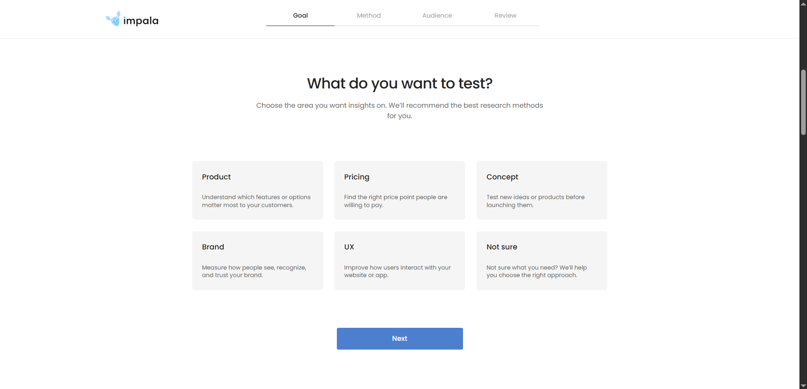
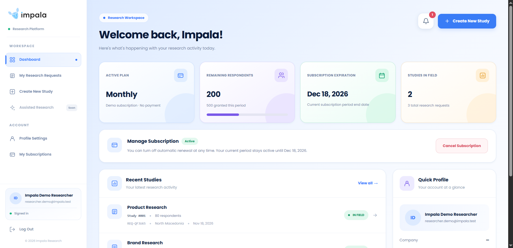
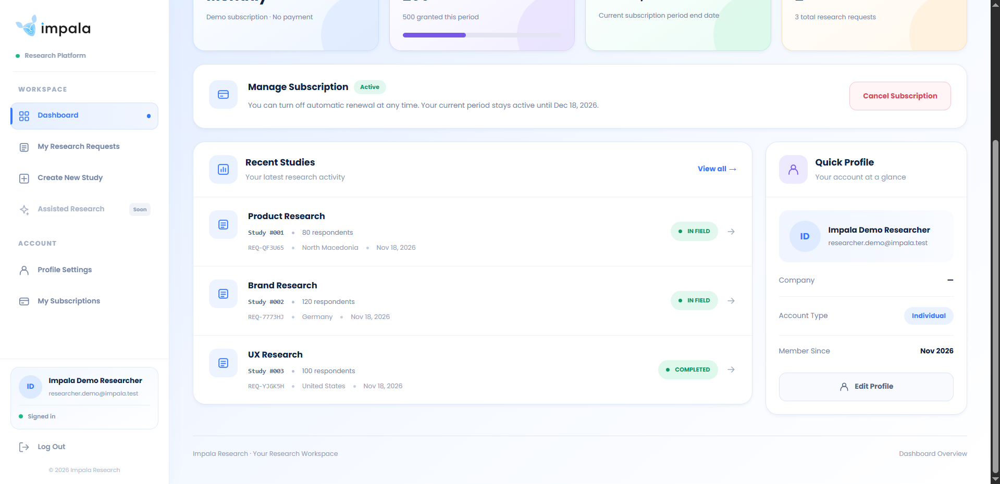
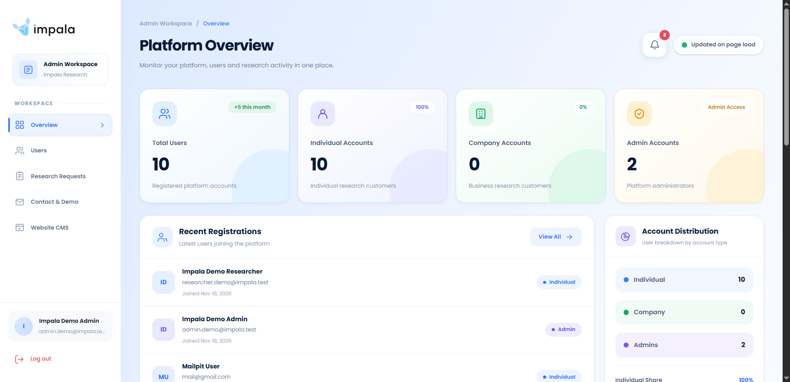
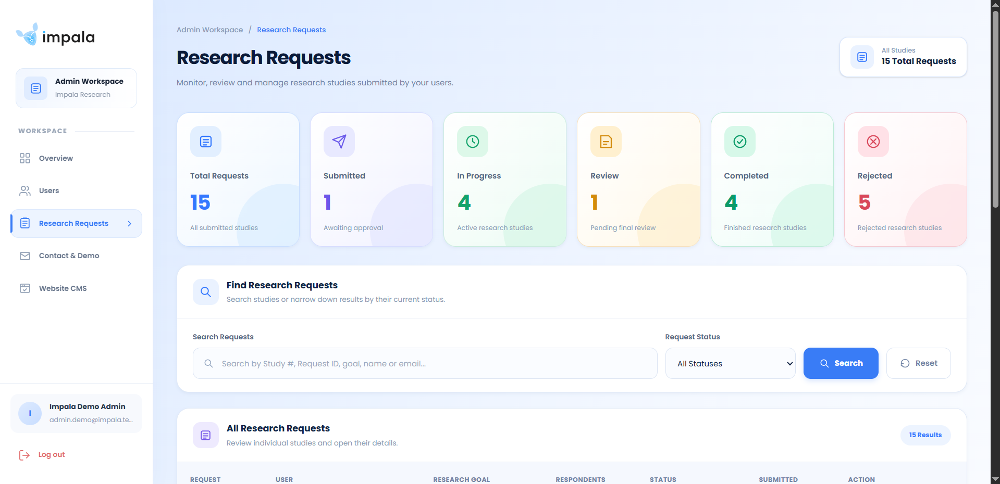

# Impala Research

**A full-stack research request and subscription management platform built with Laravel 12.**

Impala Research is a web application for planning research studies, managing subscriptions and respondent credits, tracking research requests, and coordinating research workflows through dedicated user and administrator dashboards.

The project combines a public-facing research website with an authenticated research management platform.

## Technology Stack

- **Backend:** PHP 8.2+, Laravel 12
- **Frontend:** Blade, Tailwind CSS 4, Alpine.js, JavaScript
- **Database:** MySQL or SQLite
- **Build Tools:** Vite, npm
- **Authentication:** Laravel Breeze, email verification, password reset
- **Payments:** Stripe PHP SDK and backend integration
- **Testing:** PHPUnit / Laravel feature tests

## Key Features

### Research Study Builder

- Select a research goal and target audience.
- Configure sample sizes and research timelines.
- Choose from five research methodologies:
  - Eye Tracking
  - RTM (Reaction Time Measurement)
  - Emotion Measurement
  - Clicks
  - Surveys
- Review study details before submission.
- Save a pending study when authentication is required.
- Generate unique public research identifiers, such as `REQ-QF3U65`.

The application manages research requests and workflows; it does not directly perform eye-tracking, reaction-time measurement, or other experimental data collection.

### Authentication and Account Management

- User registration and login
- Email verification and resend functionality
- Password reset
- Protected user and administrator routes
- User profile management
- Verification checks before research submission

### Subscriptions and Respondent Credits

- Monthly, semi-yearly, and yearly subscription plans
- Subscription validity and respondent balance tracking
- Respondent credit reservation when studies are submitted
- Subscription-based study limits
- Refund of reserved respondent credits when a study is rejected
- Demo subscriptions without payment
- Stripe-related backend services for checkout and billing workflows

**Payment status:** The Stripe backend is implemented, but live checkout is not enabled for this portfolio demonstration. Demo subscriptions are used to test the platform without real transactions.

### User Dashboard

- Active subscription and expiration date
- Remaining respondent credits
- Recent research studies
- Personal research request history
- Study details and status tracking
- Account and subscription information
- In-app notifications

### Administrator Dashboard

- User management
- Research request management
- Study details and filtering
- Research status transitions:
  `Submitted → In Progress → Review → Completed`
- Research rejection with a reason
- Respondent credit refunds on rejection
- Contact and demo request management
- Website content management

### Website CMS

- Edit supported website content
- Save drafts
- Preview changes
- Publish updates
- Discard unpublished changes

### Notifications

- New research submission notifications for administrators
- Research status updates for users
- Respondent credit warnings and refund notifications
- Read/unread notification management

## Research Workflow

1. A user configures a research study.
2. The system validates the request and account eligibility.
3. An active subscription and sufficient respondent credits are required.
4. The study is submitted with a unique request ID.
5. Respondent credits are reserved.
6. Administrators review and manage the study.
7. The user receives notifications about status changes.
8. Rejected studies have their reserved respondent credits returned.

## Local Installation

### Requirements

- PHP 8.2 or newer
- Composer
- Node.js and npm
- MySQL or SQLite

### 1. Clone the repository

```bash
git clone https://github.com/DarkoMitt/ImpalaResearch.git
cd ImpalaResearch
```

### 2. Install dependencies

```bash
composer install
npm install
```

### 3. Configure the environment

Copy `.env.example` to `.env`.

```bash
cp .env.example .env
```

On Windows PowerShell:

```powershell
Copy-Item .env.example .env
```

Generate the application key:

```bash
php artisan key:generate
```

Configure the database connection in `.env`.

For MySQL, set the appropriate `DB_CONNECTION`, `DB_HOST`, `DB_PORT`, `DB_DATABASE`, `DB_USERNAME`, and `DB_PASSWORD` values.

For SQLite, create `database/database.sqlite` and configure `DB_CONNECTION=sqlite`.

### 4. Run migrations and seed subscription plans

```bash
php artisan migrate
php artisan db:seed --class=SubscriptionPlanSeeder
```

### 5. Start the application

Run the Laravel server:

```bash
php artisan serve
```

In a second terminal, start Vite:

```bash
npm run dev
```

Visit:

`http://127.0.0.1:8000`

## Email Verification in Local Development

Email verification requires a configured mail transport.

For local testing, Mailpit can capture outgoing messages without delivering real emails.

Example `.env` configuration:

```dotenv
MAIL_MAILER=smtp
MAIL_HOST=127.0.0.1
MAIL_PORT=1025
MAIL_USERNAME=null
MAIL_PASSWORD=null
MAIL_FROM_ADDRESS="noreply@impala.test"
MAIL_FROM_NAME="Impala Research"
```

Mailpit's default web interface is available at:

`http://127.0.0.1:8025`

## Demo Setup

The project includes a dedicated `DemoSeeder` for local demonstration.

It creates:

- One demo administrator
- One demo researcher
- An active Monthly demo subscription
- Three example research requests
- Sample respondent credit allocations

The demo studies represent different stages of the research workflow.

### Run the DemoSeeder

Set a private demo password in `.env`:

```dotenv
DEMO_PASSWORD="replace-with-your-own-strong-password"
```

Then execute:

```bash
php artisan config:clear
php artisan db:seed --class=DemoSeeder
```

The demo seeder is restricted to local and testing environments.

### Demo Accounts

| Role | Email |
|---|---|
| Administrator | `admin.demo@impala.test` |
| Researcher | `researcher.demo@impala.test` |

Both accounts use the locally configured `DEMO_PASSWORD` when first created.

**Security:** Never commit your `.env` file or demo credentials to a public repository. Demo accounts are intended for local development, not production deployment.

## Testing

Run the Laravel test suite:

```bash
php artisan test --compact
```

At the latest local verification, the project passed **120 tests with 476 assertions**.

## Project Status

The application currently supports the core research request, subscription management, administrator workflow, notification, and CMS functionality.

The project is maintained as a portfolio demonstration.

### Current Limitations

- Live payment checkout is not enabled in the demo interface.
- A production email delivery service is not configured.
- The application does not execute research experiments or collect eye-tracking or reaction-time data.
- Some planned services, including Assisted Research, are not yet available as complete end-user workflows.
- Production deployment and hosting are not included in the current demo setup.


## Screenshots

### Landing Page


### Research Study Builder


### User Dashboard


### My Research Studies


### Admin Dashboard


### Admin Research Management



## Author

**Darko Mitovski**

Software Engineering

GitHub: [DarkoMitt](https://github.com/DarkoMitt)

## Acknowledgment

The website's visual direction originated from a Figma design prepared during the Impala Research project. This repository documents the web application implementation and subsequent platform development.